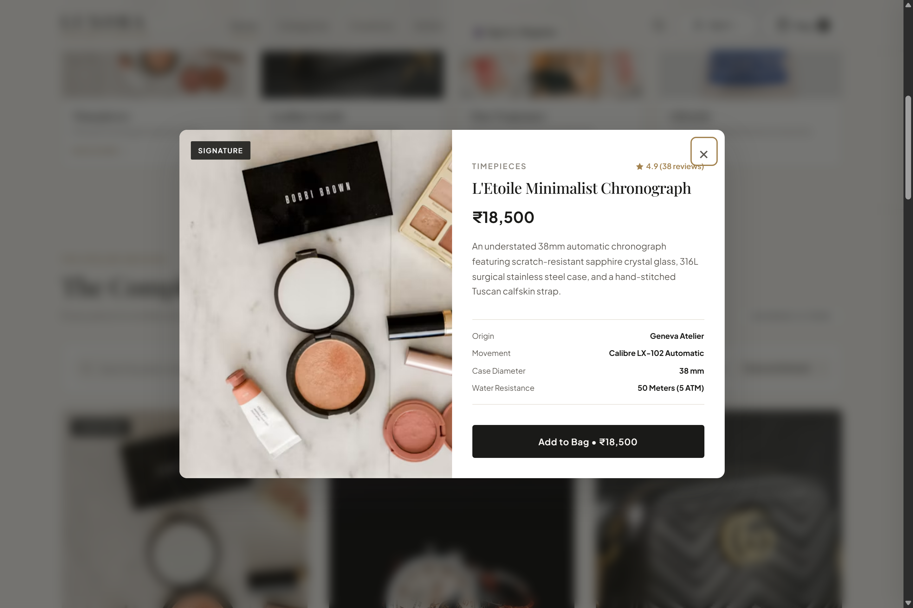
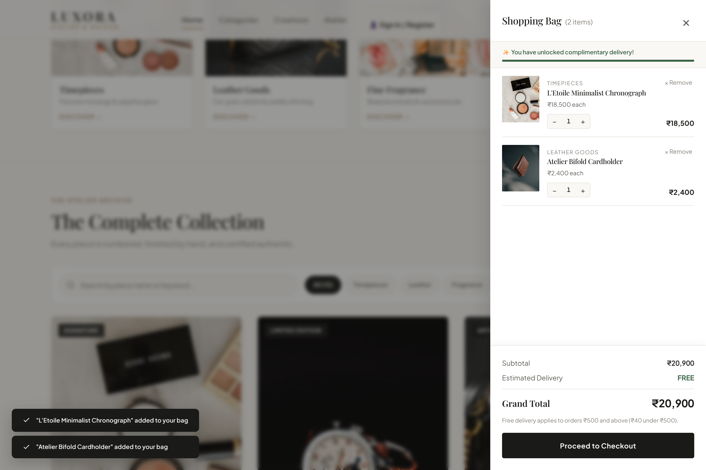
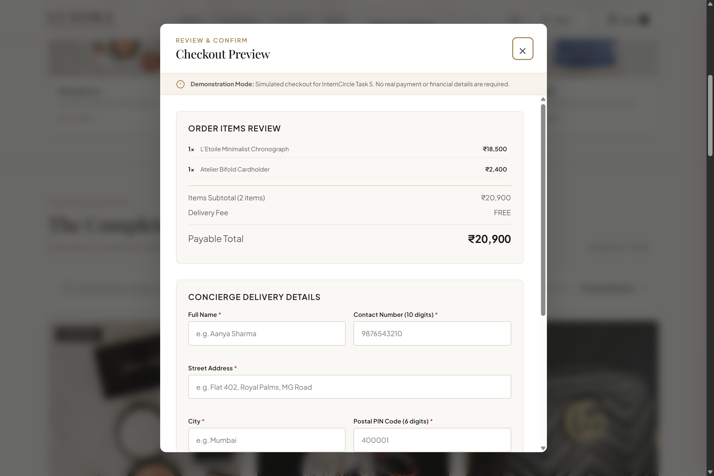
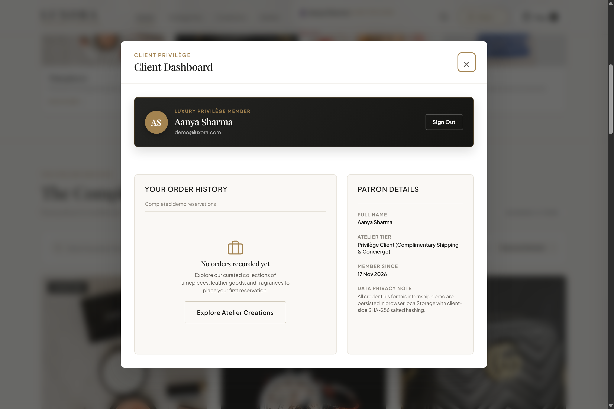

# LUXORA – Premium Mini E-Commerce Application

> An editorial luxury e-commerce experience crafted with semantic HTML5, modern modular CSS3, and vanilla JavaScript (ES6+). Developed for **InternCircle Virtual Internship – Task 5 (Full Stack Web Development)**.

[](https://github.com/shrikavin77-max/InternCircle-Mini-E-Commerce-App)
[](https://shrikavin77-max.github.io/InternCircle-Mini-E-Commerce-App/)
[](#-license)
[](#-technology-stack)
[](#-testing-instructions)

---

## 🔗 Quick Links

* **Live Website Deployment:** [https://shrikavin77-max.github.io/InternCircle-Mini-E-Commerce-App/](https://shrikavin77-max.github.io/InternCircle-Mini-E-Commerce-App/)
* **GitHub Repository:** [https://github.com/shrikavin77-max/InternCircle-Mini-E-Commerce-App](https://github.com/shrikavin77-max/InternCircle-Mini-E-Commerce-App)

---

## 📸 Genuine Application Screenshots

All screenshots below are captured directly from the live, fully functional application running in real browser environments:

### 1. Storefront Homepage & Hero Section

*Warm ivory and charcoal palette, editorial serif typography, navigation with live bag counter, and curated autumn/winter atelier spotlight.*

### 2. Product Catalogue, Search & Dynamic Filtering

*12 luxury items dynamically rendered from JavaScript objects, live keyword search, category filter chips, and price/rating sorting.*

### 3. Product Detail Quick Preview Modal

*Accessible native HTML5 `<dialog>` displaying high-resolution imagery, artisan provenance, case dimensions, water resistance specs, and quick add-to-bag.*

### 4. Interactive Slide-Out Shopping Cart Drawer

*Non-intrusive slide-out bag with dynamic free-delivery threshold progress indicator, quantity increment/decrement steppers, item removal, and subtotal calculation.*

### 5. Checkout Preview & Selectable Payment Methods

*Native modal checkout with customer destination form validation and three selectable payment tiers: Cash on Delivery (COD), Instant UPI, and Credit / Debit Card with an interactive luxury platinum card preview.*

### 6. Customer Account Dashboard & Verified Order History

*Patron welcome card, Atelier tier badge, client metadata, and persistent past orders displaying line items, totals, and confirmed payment methods.*

---

## 🌟 Project Overview

**LUXORA** is a luxury e-commerce web application engineered to deliver a serene "Quiet Luxury" shopping experience. Built from the ground up without third-party frameworks, it demonstrates enterprise-grade JavaScript architecture, clean separation of concerns, defensive storage handling, and accessible UI interactions.

The application satisfies and exceeds all requirements set forth in **InternCircle Task 5**, providing a dynamic product catalog, interactive cart operations, mathematical delivery tiering, a three-tier payment selection experience, demo client authentication with salted SHA-256 hashing, and a persistent customer account dashboard.

---

## 🎯 Task 5 Requirements & Verification Matrix

| # | Requirement | Implementation in LUXORA | Status |
|---|---|---|:---:|
| **1** | Dynamic product rendering from JavaScript objects | Generated dynamically from `PRODUCTS` dataset via `renderProductGrid()` in `js/app.js` | ✅ Verified |
| **2** | At least 8 products with `id`, `name`, `price`, `category` | 12 curated creations across 4 categories (Timepieces, Leather Goods, Fragrances, Lifestyle) with prices ranging from ₹350 to ₹26,000 | ✅ Verified |
| **3** | Add products to cart | Handled by `addToCart(id)` in `js/cart.js` with instant header badge and toast notifications | ✅ Verified |
| **4** | Increase and decrease quantities | Steppers with bounds protection via `changeQuantity(id, delta)` | ✅ Verified |
| **5** | Remove products from cart | `removeItem(id)` with immediate subtotal recalculation and notification feedback | ✅ Verified |
| **6** | Display total item count | Sum of all quantities computed using `Array.reduce()` and synchronized across header and drawer | ✅ Verified |
| **7** | Calculate subtotal using `Array.reduce()` | Pure functional calculation in `calculateTotals()` | ✅ Verified |
| **8** | Apply delivery fee or discount rule | Free delivery for subtotal $\ge$ ₹500; flat ₹40 fee below ₹500; ₹0 on empty cart | ✅ Verified |
| **9** | Format prices using Indian Rupees (INR) | Formatted via `Intl.NumberFormat` / `Number.toLocaleString('en-IN', { style: 'currency', currency: 'INR' })` | ✅ Verified |
| **10** | Show cart items, quantities, line totals, and grand total | Rich item cards with thumbnails, unit prices, steppers, computed line totals, and breakdown card | ✅ Verified |
| **11** | Display an empty-cart message | Friendly editorial empty state with illustrated bag icon and collection explore trigger | ✅ Verified |
| **12** | Checkout preview using HTML `<dialog>` | Native modal via `dialog.showModal()` with complete order breakdown and address validation | ✅ Verified |
| **13** | Save cart data using `localStorage` | Serialized to `luxora_cart_data` with defensive JSON parsing & corruption recovery | ✅ Verified |
| **14** | Responsive design for mobile and desktop | Fluid layout adapting gracefully from 320px mobile screens to 1440px+ 4K displays | ✅ Verified |

---

## 💎 Key Features

- **Quiet Luxury Design System:** Editorial aesthetic with warm ivory (`#FAF8F5`), charcoal (`#1A1A18`), and champagne-gold (`#C5A880`) accents. Premium typography pairing `Playfair Display` serif headers with `Plus Jakarta Sans` body copy.
- **Dynamic Catalogue Controls:**
  - Real-time search across piece titles, descriptions, and categories.
  - Interactive category filter chips (`All`, `Timepieces`, `Leather`, `Fragrance`, `Lifestyle`).
  - Sorting options: Price: Low to High, Price: High to Low, Highest Rated, and Featured.
  - Active filter indicators with a one-click filter reset option.
- **Product Detail Quick Preview:** Native modal popup revealing craftsmanship provenance, movement/calibre specs, case diameter, water resistance ratings, and direct add-to-bag triggers.
- **Shopping Cart Drawer:** Non-disruptive slide-out bag with interactive free-shipping progress meter, live line totals, and quantity controls.
- **Selectable Payment Methods (Simulated Demo):**
  - **1. Cash on Delivery (COD):** White-glove concierge delivery allowing customers to inspect items before paying upon physical handover.
  - **2. Instant UPI (Demo):** Simulated virtual payment address (VPA) verification supporting Google Pay, PhonePe, Paytm, and BHIM with an animated gateway authorization state.
  - **3. Credit / Debit Card (Demo):** Simulated luxury platinum card visual preview with safe demo placeholder data (`•••• •••• •••• 4242`).
  - *Strict Security Standards:* Zero collection of real card numbers, CVVs, passwords, or banking credentials. Displays prominent demo-mode disclaimers and dynamic receipts reflecting the chosen method.
- **Demo Client Authentication & Customer Dashboard:**
  - **Client Sign In & Sign Up:** Registration with full validation (password match, min 6 characters, terms acceptance). Includes show/hide password visibility toggles, Remember Me persistence, and one-click demo credentials filling.
  - **Salted SHA-256 Hashing:** Passwords are never stored in plaintext; hashed with unique client-side salts using Web Crypto (`crypto.subtle.digest('SHA-256')`).
  - **My Account Dashboard:** Personalized patron card, client details, atelier tier, and complete Order History.
  - **Order History Integration:** Completed reservations (with item details, subtotal, delivery fee, grand total, and payment method) are linked to the active demo account and stored in `localStorage`.
  - **Guest Shopping:** Non-blocking design allows guests to shop and checkout freely without creating an account.

---

## 🛠️ Technology Stack

* **Markup:** Semantic HTML5 (`<header>`, `<main>`, `<section>`, `<article>`, `<dialog>`, `<nav>`, `<aside>`)
* **Styling:** Modular CSS3 (Custom Properties/Variables, Flexbox, Grid, CSS transitions, media queries)
* **Scripting:** Vanilla JavaScript (ES6+ Modules, Closures, Event Delegation, `Array.reduce()`, Template Literals)
* **Cryptography:** Native Web Crypto API (`window.crypto.subtle.digest('SHA-256')`)
* **Persistence:** Browser `localStorage` and `sessionStorage` with defensive JSON parsing
* **Server (Local):** Zero-dependency static HTTP server built with Node.js built-ins (`http`, `fs`, `path`)
* **Deployment:** GitHub Pages (Static root deployment)

---

## 🧮 Delivery Fee Calculation Rules

The delivery fee is computed purely in `calculateTotals()` inside `js/cart.js`:

$$\text{Delivery Fee} = \begin{cases} 
₹0 & \text{if Subtotal} = ₹0 \text{ (Empty Cart)} \\
₹0 & \text{if Subtotal} \ge ₹500 \text{ (Free Delivery Threshold)} \\
₹40 & \text{if Subtotal} < ₹500 \text{ (Standard Delivery)} 
\end{cases}$$

$$\text{Grand Total} = \text{Subtotal} + \text{Delivery Fee}$$

### Concrete Example Scenarios:
1. **Empty Cart:** Subtotal = ₹0 $\rightarrow$ Delivery = ₹0 $\rightarrow$ **Grand Total = ₹0**
2. **Leather Cable Wrap (1x):** Subtotal = ₹350 $\rightarrow$ Delivery = ₹40 $\rightarrow$ **Grand Total = ₹390**
3. **Pure Brass Key Fob (1x):** Subtotal = ₹450 $\rightarrow$ Delivery = ₹40 $\rightarrow$ **Grand Total = ₹490**
4. **Silk Pocket Square (1x):** Subtotal = ₹500 $\rightarrow$ Delivery = ₹0 $\rightarrow$ **Grand Total = ₹500** *(Free delivery unlocked!)*
5. **L'Etoile Chronograph (1x):** Subtotal = ₹18,500 $\rightarrow$ Delivery = ₹0 $\rightarrow$ **Grand Total = ₹18,500**

---

## 🔐 Demo Authentication & Test Credentials

For evaluation and testing convenience, the application automatically initializes with a seed demo patron:

| Field | Demo Credential |
|:---|:---|
| **Email** | `demo@luxora.com` |
| **Password** | `Password123` |
| **Pre-loaded Patron** | Aanya Sharma (Luxury Privilège Member) |
| **One-Click Fill** | Click the **"⚡ Fill Demo Credentials"** button on the Sign In form |

> [!NOTE]
> **Educational Demonstration Notice:** This is a frontend-only portfolio project for InternCircle Task 5. While passwords are securely hashed with salted SHA-256 before storage in `localStorage`, client-side authentication is for demonstration only and should not be used as production-grade authentication.

---

## 📁 Project Folder Structure

```
InternCircle-Mini-E-Commerce-App/
├── index.html                   # Semantic HTML5 storefront & native dialog structures
├── server.js                    # Zero-dependency local Node.js development server
├── README.md                    # Comprehensive documentation & evaluation guide
├── css/
│   ├── variables.css            # Design tokens (warm ivory palette, typography, shadows)
│   ├── base.css                 # Modern CSS reset, typography base, container utilities
│   ├── components.css           # Header, cards, drawer, stepper, dialog, toasts
│   └── responsive.css           # Mobile, tablet, and desktop media queries
├── js/
│   ├── products.js              # Curated 12-product catalog dataset
│   ├── cart.js                  # Cart state, localStorage sync, Array.reduce() calculations
│   ├── auth.js                  # Demo authentication, SHA-256 hashing, dashboard & order history
│   └── app.js                   # DOM controller, search/filter/sort, event delegation, dialogs
├── assets/
│   └── images/                  # Storefront screenshots & UI assets
├── docs/
│   └── screenshots/             # 6 genuine high-resolution application screenshots
└── .gitignore                   # Standard git exclusions
```

---

## 🚀 Installation & Local Execution

Because LUXORA is built strictly using standard web technologies with **zero build steps or external dependencies**, you can run it immediately:

### Option 1: Native Node.js Server (Recommended)
Clone the repository and run the built-in server:
```bash
git clone https://github.com/shrikavin77-max/InternCircle-Mini-E-Commerce-App.git
cd InternCircle-Mini-E-Commerce-App
node server.js
```
Open **`http://localhost:3000`** in any modern web browser.

### Option 2: Direct File Open
Double-click `index.html` in your file explorer, or right-click and choose **Open with > Chrome / Edge / Firefox / Safari**. All styles and assets use relative paths.

### Option 3: VS Code Live Server
1. Open the project folder in Visual Studio Code.
2. Install the **Live Server** extension (`ritwickdey.LiveServer`).
3. Right-click `index.html` and click **"Open with Live Server"**.

### Option 4: Python HTTP Server
```bash
python -m http.server 8000
```
Visit `http://localhost:8000` in your browser.

---

## 🧪 Testing Instructions

The repository includes comprehensive automated test suites verifying functional behavior, cart math, payment flows, and security requirements.

### Running Test Suites:
Run the tests using Node.js:
```bash
# 1. Run Core Catalog & Cart Math Tests (41 tests)
node scratch/run-tests.js

# 2. Run Payment Method Flow Tests (17 tests)
node scratch/payment-test.js

# 3. Run Demo Authentication & Customer Account Tests (18 tests)
node scratch/auth-test.js

# 4. Run Comprehensive Submission-Readiness Suite (23 tests)
node scratch/final-audit-suite.js
```

### Automated Test Coverage Summary:
* ✅ **Product Catalog Integrity:** All 12 items possess valid IDs, names, categories, numeric prices, descriptions, and active image URLs.
* ✅ **Cart State & `Array.reduce()`:** Subtotal, item count, quantity increment/decrement, bounds checking, and empty cart resets.
* ✅ **Delivery Threshold Boundary:** ₹0 on empty cart, ₹40 fee when subtotal < ₹500, and free delivery when subtotal $\ge$ ₹500.
* ✅ **LocalStorage Resilience:** Safe serialization, restoration on page reload, and graceful fallback on corrupted JSON.
* ✅ **Payment Simulation:** COD, Instant UPI with virtual payment validation, and Credit/Debit Card preview.
* ✅ **Security Rules:** Zero requests for card numbers, CVVs, or PINs; salted SHA-256 client password hashing.

---

## ⚠️ Known Limitations

1. **Frontend Demo Authentication:** Authentication is client-side and stores salted SHA-256 password hashes in `localStorage`. In a real-world enterprise application, authentication must be managed by a secure backend server using HTTP-only cookies, JWTs, and database-level bcrypt/argon2 hashing.
2. **Simulated Payment Gateways:** To ensure customer safety and adhere to internship rules, no real banking transactions are executed. All payment confirmations are simulated educational workflows.
3. **Static CDN Product Imagery:** Product photos are hosted on high-availability Unsplash CDNs. An active internet connection is required to render images when opening locally without cached assets.

---

## 🌐 GitHub Pages Deployment Guide

The application is deployed live on GitHub Pages from the repository root:

1. Repository Settings: [https://github.com/shrikavin77-max/InternCircle-Mini-E-Commerce-App/settings/pages](https://github.com/shrikavin77-max/InternCircle-Mini-E-Commerce-App/settings/pages)
2. Source: **Deploy from a branch**
3. Branch: `main`, Folder: `/ (root)`
4. Live Storefront URL: **[https://shrikavin77-max.github.io/InternCircle-Mini-E-Commerce-App/](https://shrikavin77-max.github.io/InternCircle-Mini-E-Commerce-App/)**

---

## 📜 License & Acknowledgments

This project was engineered as an official submission for the **InternCircle Virtual Internship Program – Task 5 (Full Stack Web Development)**.

* **Developer:** Shri Kavin D K
* **Task:** Task 5 — Full Stack Web Development (Mini E-Commerce Storefront)
* **Brand:** LUXORA Atelier & Maison (Fictional luxury portfolio brand)
