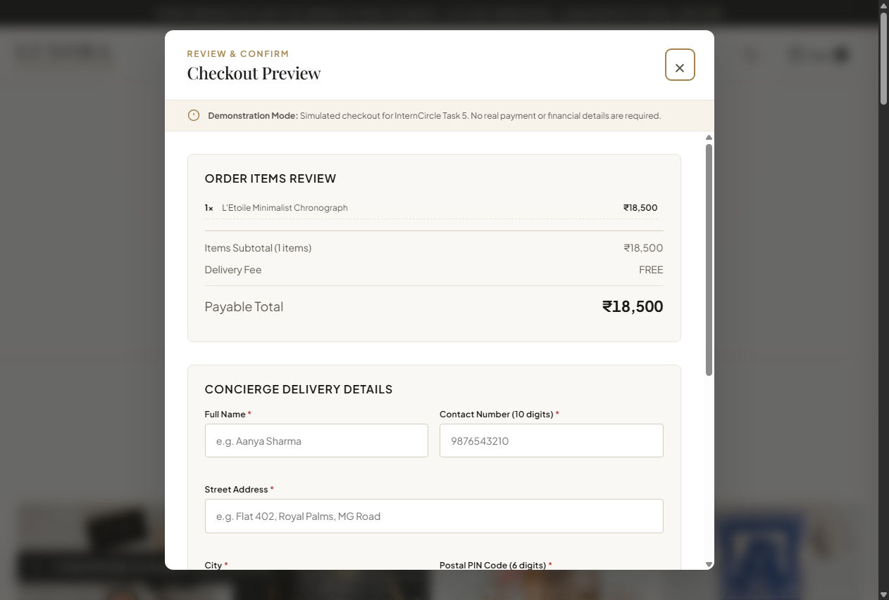

# LUXORA — Maison & Atelier Storefront

> An editorial luxury e-commerce experience crafted with semantic HTML5, modern modular CSS3, and vanilla JavaScript (ES6+). Built for **InternCircle Virtual Internship – Task 5 (Full Stack Web Development)**.

---

## 🌟 Overview

**LUXORA** is a premium e-commerce application designed around a "Quiet Luxury" visual language. It blends an editorial warm-ivory aesthetic with a fully functional client-side e-commerce engine: dynamic catalog rendering, search and multi-criteria filtering, responsive cart drawer, real-time totals with delivery business rules, persistent storage via `localStorage`, and an accessible checkout preview powered by native HTML5 `<dialog>`.

---

## 🎯 Official Task 5 Requirements & Implementation

| # | Requirement | Implementation in LUXORA |
|---|---|---|
| **1** | Dynamic product rendering from JavaScript objects | Generated dynamically from `PRODUCTS` array via `renderProductGrid()` in `js/app.js` |
| **2** | At least 8 products with `id`, `name`, `price`, `category` | 12 curated fictional creations across 4 categories with rich metadata |
| **3** | Add products to cart | `addToCart(id)` in `js/cart.js` with instant badge updates |
| **4** | Increase and decrease quantities | `changeQuantity(id, delta)` with upper/lower bounds protection |
| **5** | Remove products from cart | `removeItem(id)` with immediate recalculation and toast feedback |
| **6** | Display total item count | Sum of all quantities computed via `Array.reduce()` and displayed on header badge & drawer |
| **7** | Calculate subtotal using `Array.reduce()` | Pure functional calculation in `calculateTotals()` |
| **8** | Apply delivery fee rule | Free delivery for orders ≥ ₹500; flat ₹40 fee below ₹500; ₹0 on empty cart |
| **9** | Format prices using Indian Rupees (INR) | Formatted with `Number.toLocaleString('en-IN', { style: 'currency', currency: 'INR' })` |
| **10** | Show cart items, quantities, line totals, and grand total | Rich line items with thumbnails, unit prices, steppers, line totals, and breakdown |
| **11** | Display an empty-cart message | Friendly editorial empty state with illustrated bag icon and collection explore trigger |
| **12** | Checkout preview using HTML `<dialog>` | Native modal via `dialog.showModal()` with order breakdown and address validation |
| **13** | Save cart data using `localStorage` | Serialized to `luxora_cart_data` with defensive JSON parsing & fallback |
| **14** | Responsive design for mobile and desktop | Fluid layout from 320px mobile screens to large desktop monitors |

---

## 💎 Features

- **Warm Ivory Editorial Design:** Refined color palette (`#FAF8F5`, `#1A1A18`, `#A38350`), serif typography (`Playfair Display`), and clean UI sans-serif (`Plus Jakarta Sans`).
- **Interactive Catalogue Toolbar:**
  - Real-time search across product titles, categories, and descriptions.
  - Category pill filters (`Timepieces`, `Leather Goods`, `Fragrances`, `Lifestyle`).
  - Price sorting (Low to High, High to Low, Highest Rated, Featured).
  - Empty search results state with one-click filter reset.
- **Product Detail Quick Preview:** Click any product card or "Quick Preview" to open an in-depth modal showing product specifications, provenance, rating, and quick add-to-bag.
- **Slide-Out Cart Drawer:** Non-disruptive slide-out bag with interactive free-shipping progress meter.
- **Event Delegation Architecture:** Click handlers mounted on parent containers to prevent memory leaks.
- **Selectable Payment Methods (Simulated Demo):**
  - **1. Cash on Delivery (COD):** White-glove concierge delivery allowing customers to inspect items before paying upon physical handover.
  - **2. Instant UPI (Demo):** Simulated virtual payment address (VPA) verification supporting Google Pay, PhonePe, Paytm, and BHIM with an animated gateway authorization state.
  - **3. Credit / Debit Card (Demo):** Simulated luxury platinum card visual preview with safe demo placeholder data (`•••• •••• •••• 4242`).
  - *Security First:* Strictly zero collection of real card numbers, CVVs, passwords, or banking credentials. Displays prominent demo-mode disclaimers and dynamic receipts reflecting the chosen method.
- **Client Authentication & Account Dashboard (Demo):**
  - **Client Sign In & Sign Up:** Registration with full validation (password match, min 6 characters, terms acceptance). Includes show/hide password visibility toggles, Remember Me persistence, and one-click demo credentials filling.
  - **Salted SHA-256 Hashing:** Passwords are never stored in plaintext; hashed with unique client-side salts using Web Crypto (`crypto.subtle.digest('SHA-256')`).
  - **My Account Dashboard:** Personalized patron card, client details, atelier tier, and complete Order History.
  - **Order History Integration:** Completed reservations (with item details, subtotal, delivery fee, grand total, and payment method) are linked to the active demo account and stored in `localStorage`.
  - **Guest Shopping:** Non-blocking design allows guests to shop and checkout freely without creating an account.

---

## 🔐 Demo Authentication & Credentials

For evaluation and testing convenience, the application automatically initializes with a seed demo patron:

| Field | Demo Credential |
|:---|:---|
| **Email** | `demo@luxora.com` |
| **Password** | `Password123` |
| **Pre-loaded Patron** | Aanya Sharma (Luxury Privilège Member) |

> [!NOTE]
> **Educational Demonstration Notice:** This is a frontend-only portfolio project for InternCircle Task 5. While passwords are securely hashed with salted SHA-256 before storage in `localStorage`, client-side authentication is for demonstration only and should not be used as production-grade authentication.

---

---

## 🧮 Delivery Fee Calculation Rules

The delivery fee is calculated dynamically inside `calculateTotals()` in `js/cart.js`:

$$\text{Delivery Fee} = \begin{cases} 
₹0 & \text{if Subtotal} = ₹0 \text{ (Empty Cart)} \\
₹0 & \text{if Subtotal} \ge ₹500 \text{ (Free Delivery)} \\
₹40 & \text{if Subtotal} < ₹500 \text{ (Standard Delivery)} 
\end{cases}$$

$$\text{Grand Total} = \text{Subtotal} + \text{Delivery Fee}$$

*Example Scenarios:*
1. **Empty Bag:** Subtotal = ₹0 $\rightarrow$ Delivery = ₹0 $\rightarrow$ Grand Total = ₹0.
2. **Key Fob (1x):** Subtotal = ₹450 $\rightarrow$ Delivery = ₹40 $\rightarrow$ Grand Total = ₹490.
3. **Silk Pocket Square (1x):** Subtotal = ₹500 $\rightarrow$ Delivery = ₹0 $\rightarrow$ Grand Total = ₹500 *(Free delivery threshold reached)*.
4. **L'Etoile Chronograph (1x):** Subtotal = ₹18,500 $\rightarrow$ Delivery = ₹0 $\rightarrow$ Grand Total = ₹18,500.

---

## 📁 Project Structure

```
LUXORA/
├── index.html              # Semantic HTML5 layout & native dialog structures
├── css/
│   ├── variables.css       # Design tokens (warm ivory palette, typography, shadows)
│   ├── base.css            # Modern CSS reset, typography base, container utilities
│   ├── components.css      # Header, cards, drawer, stepper, dialog, toasts
│   └── responsive.css      # Mobile, tablet, and desktop media queries
├── js/
│   ├── products.js         # Curated 12-product catalog dataset
│   ├── cart.js             # Cart state, localStorage sync, Array.reduce() calculations
│   ├── auth.js             # Demo authentication, SHA-256 hashing, dashboard & order history
│   └── app.js              # DOM controller, search/filter/sort, event delegation, dialogs
├── assets/
│   ├── images/             # Product photography assets
│   └── icons/              # UI vector iconography
├── .gitignore              # Standard git exclusions (OS, IDE, logs)
└── README.md               # Comprehensive project documentation
```

---

## 🚀 How to Run Locally

Because LUXORA is built strictly using standard web technologies with **zero build steps or external dependencies**, you can run it immediately in any modern browser:

### Option 1: Direct File Open
Double-click `index.html` in your file explorer, or right-click and choose **Open with > Chrome / Edge / Firefox / Safari**.

### Option 2: VS Code Live Server
1. Open the `LUXORA` folder in Visual Studio Code.
2. Install the **Live Server** extension (`ritwickdey.LiveServer`).
3. Right-click `index.html` and click **"Open with Live Server"** (runs at `http://127.0.0.1:5500`).

### Option 3: Python Local Server
Run in PowerShell / Terminal inside the project root:
```bash
# Python 3
python -m http.server 8000
```
Then visit `http://localhost:8000` in your browser.

---

## 🌐 GitHub Pages Deployment Guide

LUXORA is 100% static and requires no build pipeline, making it directly deployable on **GitHub Pages**:

1. Initialize git and commit your files:
   ```bash
   git init
   git add .
   git commit -m "feat: complete LUXORA e-commerce storefront for Task 5"
   ```
2. Create a new repository named `luxora-store` on GitHub.
3. Link your local repository and push:
   ```bash
   git remote add origin https://github.com/<your-username>/luxora-store.git
   git branch -M main
   git push -u origin main
   ```
4. In your GitHub repository:
   - Navigate to **Settings** > **Pages** (under Code and automation).
   - Under **Build and deployment** > **Source**, choose **Deploy from a branch**.
   - Select Branch: `main` and Folder: `/ (root)`.
   - Click **Save**.
5. Your live storefront will be published at:
   `https://<your-username>.github.io/luxora-store/`

---

## 📸 Screenshots

*(Placeholders for documentation and submission report)*

| Desktop Storefront & Hero | Interactive Cart Drawer |
|:---:|:---:|
|  |  |

| Product Detail Quick View | Checkout Preview Modal |
|:---:|:---:|
|  |  |

---

## 🧑‍🏫 Mentoring & Architectural Insights

### 1. Separation of Concerns
- `products.js` acts as our database. It does not know anything about HTML or the DOM.
- `cart.js` handles pure business logic (adding, decrementing, summing with `reduce()`, and updating `localStorage`).
- `app.js` is the coordinator. It listens to user gestures and asks `cart.js` to modify the state, then calls `renderCart()` to update the view.

### 2. Why `Array.reduce()`?
Rather than using a mutable `for` loop with external index variables, `Array.reduce()` transforms an array into a single accumulated value cleanly:
```javascript
const subtotal = cart.reduce((accumulator, item) => {
  const product = getProductById(item.id);
  return accumulator + (product ? product.price * item.quantity : 0);
}, 0);
```

### 3. Safe `localStorage` Patterns
Browser storage can fail (private browsing quota limits, corrupt stored strings, user clearing cache). We defend against this by wrapping read/write in `try...catch` blocks and verifying data schema before loading:
```javascript
try {
  const rawData = localStorage.getItem('luxora_cart_data');
  cart = rawData ? JSON.parse(rawData) : [];
} catch (e) {
  cart = []; // Fail gracefully to an empty cart
}
```

---

## 📜 License
This project was created as an educational submission for the **InternCircle Virtual Internship Program – Task 5**.
All brand marks and product names are fictional.
